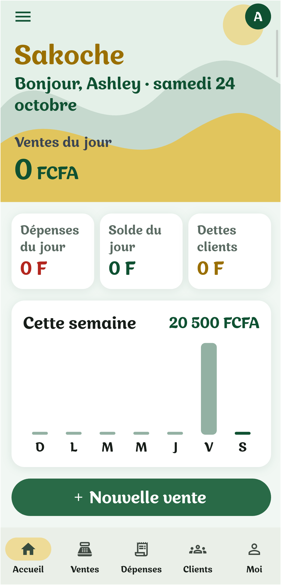
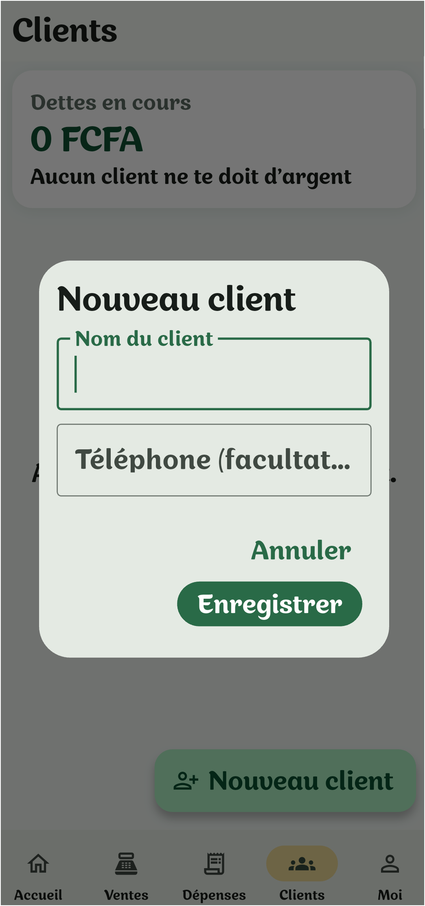
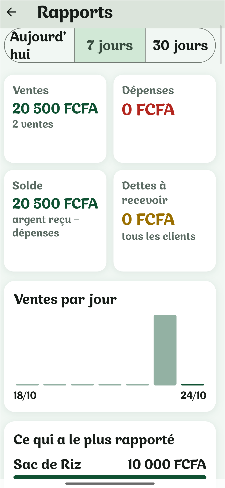

# Sakoche

**Le carnet de caisse du petit commerçant, dans le téléphone.**
Application Android qui fonctionne **sans internet**, pour noter ses ventes, ses dépenses et les dettes de ses clients.

<!-- Remplace les chemins ci-dessous par tes vraies captures d'écran -->





## Le problème

Beaucoup de petits commerçants notent encore leurs ventes, leurs dépenses et les dettes de leurs clients sur un cahier. Les pages se perdent, les calculs se trompent, et on ne voit jamais clairement ce qu'on gagne.

## La solution

Sakoche remplace le cahier, avec une règle simple : **noter une vente doit prendre quelques secondes**.

## Fonctionnalités

- **Ventes rapides** : un montant suffit. Une note libre facultative (« pour quoi ? ») aide à se souvenir, avec des raccourcis vers les dernières notes utilisées.
- **Corriger ou supprimer** une vente.
- **Dépenses** classées par catégorie (marchandises, transport, loyer...).
- **Clients et dettes** : chaque dette a son motif, sa date et ses remboursements. Le reste à payer se recalcule tout seul. Une vente peut être faite à crédit.
- **Accueil** : ventes du jour, dépenses, solde, dettes des clients et graphique de la semaine.
- **Rapports** : sur un jour, 7 jours ou 30 jours, avec ce qui a le plus rapporté.
- **Sauvegarde et restauration** des données dans un fichier (WhatsApp, e-mail...).
- **100 % hors connexion** : les données restent sur le téléphone.

## Choix de conception

- **Peu de gestes.** Le clavier s'ouvre dès l'écran de vente, et un seul champ est obligatoire. Les détails sont toujours facultatifs.
- **Pas de catalogue d'articles à préparer.** Un commerçant peut vendre des pommes un jour et des oignons le lendemain : une simple note libre lui suffit.
- **L'argent réellement reçu.** Le solde du jour compte l'argent encaissé : une vente à crédit n'y entre qu'au moment du remboursement.
- **Des données qui évoluent sans rien perdre.** La base de données évolue de version en version (migrations) sans effacer les données déjà enregistrées.

## Technologies

Flutter (Dart) · SQLite (`sqflite`) · `shared_preferences` · `share_plus` · `file_picker`

## Structure du code

```text
lib/
├── main.dart                 # l'application, le menu et les onglets
├── accueil_page.dart         # l'accueil illustré et fixe
├── nouvelle_vente_page.dart  # enregistrer une vente
├── ventes_page.dart          # liste des ventes, modifier, supprimer
├── depenses_page.dart        # les dépenses
├── clients_page.dart         # la liste des clients
├── client_page.dart          # le compte d'un client : dettes et remboursements
├── rapports_page.dart        # les rapports
├── parametres_page.dart      # sauvegarde, restauration, effacement
├── base_de_donnees.dart      # tout ce qui parle à SQLite, avec les migrations
├── sauvegarde.dart           # export et import du fichier de données
└── client.dart, vente.dart, depense.dart, profil.dart, outils.dart
test/
└── calculs_test.dart         # tests des calculs (montants, dates, dettes)
```

## Lancer le projet

```bash
flutter pub get
flutter run        # téléphone Android branché, débogage USB activé
flutter test       # lance les tests
```

Pour fabriquer l'application installable :

```bash
flutter build apk --release
```

Le fichier se trouve ensuite dans `build/app/outputs/flutter-apk/app-release.apk`.

## Télécharger l'application

Un APK est disponible dans les [releases](../../releases) du dépôt.

## Pistes pour la suite

- Tests auprès de vrais commerçants et ajustements.
- Rappels pour les dettes anciennes.
- Synchronisation entre plusieurs téléphones, si le besoin se confirme.

---

Projet personnel réalisé pour apprendre le développement mobile, en partant d'un besoin réel.
